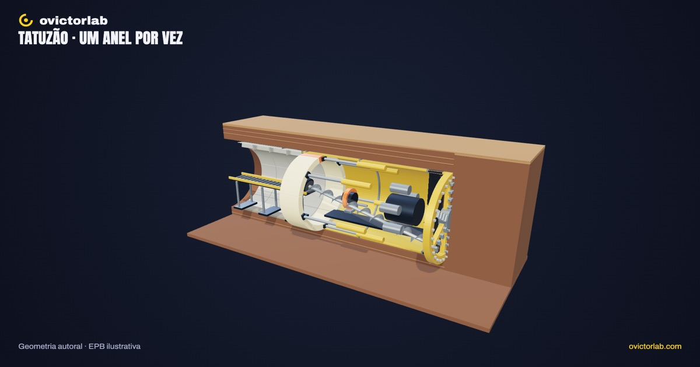
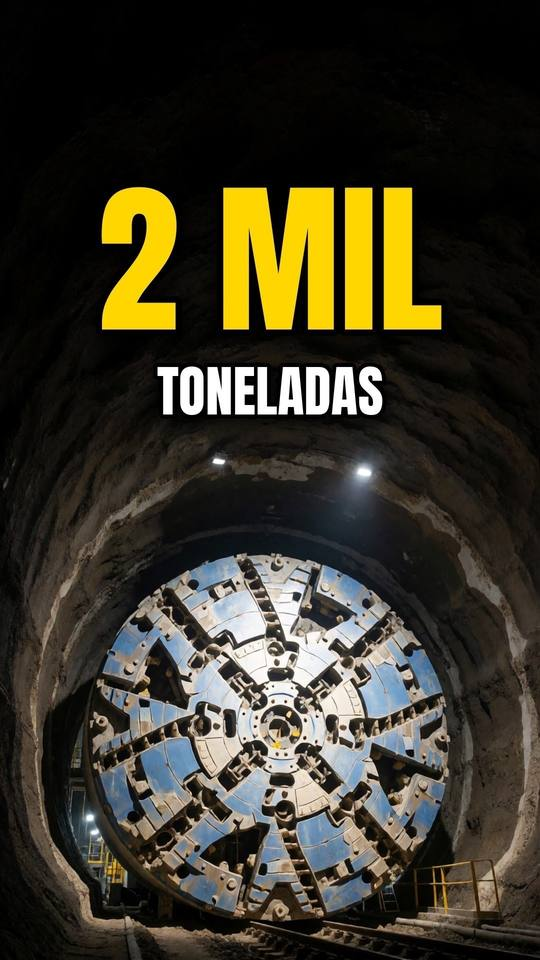

# Tatuzão construindo o metrô

**[Abrir a experiência →](https://victorsodre.github.io/tatuzao/)** · [Os 10 experimentos](docs/COLECAO.md) · [Publicação e manutenção](docs/PUBLICACAO.md)

[](https://victorsodre.github.io/tatuzao/)

**Como o tatuzão cava e deixa o túnel pronto atrás dele?**

Uma máquina de tipo explicitamente escolhido, um trecho curto de solo e um ciclo ilustrativo de escavação, transporte de material e instalação do revestimento.

Direção e autoria editorial: **Victor Sodré / ovictorlab**. [Site](https://ovictorlab.com/) · [Referência Fusquinha](https://victorsodre.github.io/fusquinha/) · [Repositório](https://github.com/victorsodre/tatuzao).

## Entenda no vídeo

<a href="https://www.youtube.com/watch?v=KV6RWi8-zE8"></a>

**[Como o tatuzão cava o metrô sem a rua afundar? (a terra que ele corta segura o túnel)](https://www.youtube.com/watch?v=KV6RWi8-zE8)**

Acompanhe como a escavação sustenta a frente do túnel. No experimento, controle o avanço e a montagem do revestimento.

O player incorporado fica [na página do experimento](https://victorsodre.github.io/tatuzao/#video), com carregamento por clique e sem reprodução automática.

## Por que desenvolver

O primeiro Reel do tatuzão registrou 4.435 visualizações; o Short posterior do tema tinha 1.701 no YouTube. Consulta em 07/11/2026. Métricas acumuladas são sinais de interesse; não comprovam demanda pelo aplicativo ou alcance orgânico.

- [Tatuzão — Instagram](https://www.instagram.com/reel/DechD0FCli6/)
- [Tatuzão — YouTube](https://www.youtube.com/watch?v=KV6RWi8-zE8)

## Começar por aqui

1. [Escopo e critérios de conclusão](docs/ESCOPO.md).
2. [Lista de execução](docs/EXECUCAO.md).
3. [Identidade visual do ovictorlab](docs/IDENTIDADE-VISUAL.md).
4. [Arquitetura proposta e reaproveitamento do Fusquinha](docs/ARQUITETURA.md).
5. [Assets, fontes e pendências de apuração](docs/ASSETS-E-FONTES.md).
6. [Manutenção, validação e publicação](docs/MANUTENCAO.md).
7. [Decisões e estado do projeto](docs/DECISOES.md).
8. [Textos para o X](POSTAGENS-X.md) e [ordem da coleção](docs/COLECAO.md).

**Versão entregue:** EPB educativa autoral sob uma rua, com guia "Por que a rua não afunda?" (câmara e rosca, escudo, argamassa, medição na rua), oito conjuntos selecionáveis, corte longitudinal, avanço de uma largura de anel e montagem de cinco segmentos mais a chave. Pausa, linha do tempo reversível, isolamento, foco, tour, malha, tela cheia e PNG horizontal/vertical.

## Executar

Node.js 22.18 ou superior; versões fixadas no lockfile.

```sh
npm ci
npm run dev
npm test
npm run check
npm run build
npm run preview
```

`dev` abre em `http://127.0.0.1:4311/`. O build em `dist/` usa caminhos relativos e pode ser servido em subpasta. `preview` informa sua porta ao iniciar. Não há backend, LLM, credenciais ou acesso à GPU de produção.

## Conferir a entrega

- [Apuração e simplificações](docs/APURACAO.md): fontes primárias e limites do modelo educativo.
- [Validação](docs/VALIDACAO.md): catorze testes (09/11/2026), 91 verificações de navegador, capturas reais e limites de cobertura.
- [Arquitetura](docs/ARQUITETURA.md) e [manutenção](docs/MANUTENCAO.md): estado determinístico, geometria e procedimentos de alteração.

A cena explica o ciclo; não calcula pressão, recalque, estabilidade do solo ou capacidade de produção. O controle da rosca é qualitativo. Dimensões, apoios e trajetos são ilustrativos. Não é réplica de uma máquina específica.

Aplicação publicada no GitHub Pages, com vídeo incorporado e links conferidos. Os rascunhos do X permanecem para publicação manual por Victor em [POSTAGENS-X.md](POSTAGENS-X.md).
